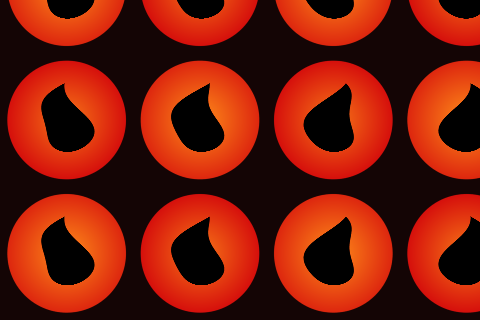

# Shader de fragmentos · Silueta de llama en círculo

**Autor:** Roberto Rodríguez Guillén\
**Demo (CodeSandbox):** https://codesandbox.io/p/sandbox/dzlvfr \
**Vídeo de captura:** https://youtu.be/KBbTZp9TGbs


Rejilla de emblemas circulares de color naranja-rojo, cada uno con una llama negra que ondula y parece subir. La velocidad de la llama depende de la posición horizontal del ratón.

| Archivo | Descripción |
|---|---|
| `llama_min.frag` | Versión de entrega, minificada (**473 bytes**) |
| `llama_legible.frag` | Misma versión, comentada línea a línea |
| `script_shader_flame.js` + `index.html` | Integración en CodeSandbox con three.js |

---

## Cómo ejecutarlo

**Editor de The Book of Shaders:** pegar el contenido de `llama_min.frag` (o de `llama_legible.frag`) en <http://editor.thebookofshaders.com>. Mover el ratón de izquierda a derecha cambia la velocidad de la llama.

**CodeSandbox:** añadir `script_shader_flame.js` al proyecto de la práctica y cargarlo desde `index.html`:

```html
<script src="script_shader_flame.js" type="module"></script>
```

---

## Motivación

Desde que leí el enunciado quise que el shader fuera un emblema o una silueta de videojuego. Probé a replicar algunos logos concretos, pero era bastante complejo, así que busqué algo más sencillo. Elegí la idea de un emblema de llama, inspirado en los símbolos de tipo fuego de Pokémon, que es mi favorito. 

Como la tarea pide un patrón generativo y un comportamiento dinámico, la idea acabó siendo una rejilla de emblemas. En cada uno la llama ondula como si ardiera, desfasada de sus vecinas, y la velocidad cambia con el ratón.

---

## Desarrollo

### 1. Rejilla de celdas

Se parte del esquema de la sección *Patrones y generativos* del guion: `floor` indica en qué celda está el píxel y `fract` da la posición dentro de ella. Se divide por la **altura** de la ventana (no por la resolución completa) para que las celdas sean cuadradas en cualquier pantalla. Después se recentra cada celda en el rango −1…1, de modo que el origen queda en su centro:

```glsl
vec2 st = gl_FragCoord.xy / u_resolution.y * scale;   // scale = 3 celdas en vertical
vec2 celda = floor(st);
st = fract(st) * 2.0 - 1.0;
```

### 2. Círculo de fondo

El círculo se dibuja con la distancia al centro (`length`), igual que el círculo del guion, pero con `smoothstep` en lugar de `step` para que el borde no tenga *aliasing*:

```glsl
float r = length(st);
float enCirculo = 1.0 - smoothstep(0.88, 0.9, r);
```

El color es un degradado radial con `mix`, de naranja en el centro a rojo en el borde. Las celdas alternas se distinguen por paridad con `mod(celda.x + celda.y, 2.0)`, el mismo truco del damero del guion: a esas celdas se les suma 0.2 al factor de mezcla para que sean un poco más rojas.

### 3. Forma de la llama: una gota

En GLSL no hay primitivas, así que la llama se define procedimentalmente: para cada altura se calcula el **ancho** que tiene la llama y se pinta el píxel si `|x|` es menor que ese ancho.

Con `u` como altura relativa (0 en la base, 1 en la punta), el ancho es:

```glsl
float u = (q.y + 0.6) / 1.3;
float ancho = 1.2 * sqrt(max(u, 0.0)) * (1.0 - u);
```

- `sqrt(u)` crece muy deprisa al principio y redondea la base.
- `(1.0 - u)` llega a cero de forma lineal y afila la punta.
- Su producto da una silueta de gota, con el máximo hacia un tercio de la altura.

La máscara se obtiene con `smoothstep(0.0, 0.02, ancho - abs(q.x))`, que vale 1 dentro de la llama, 0 fuera y tiene un borde suave.

**Problema encontrado:** en la primera versión usé `1.0 - smoothstep(ancho - 0.02, ancho + 0.02, abs(q.x))`. Por debajo de la base, donde el ancho es 0, esa expresión vale 0.5 justo en `x = 0` y aparecía una línea fina vertical bajo la llama. Al reescribirla como `smoothstep(0.0, 0.02, ancho - abs(q.x))`, el resultado es 0 cuando el ancho es 0 y la línea desaparece.

### 4. Movimiento: la llama ondula y sube

El movimiento sale de deformar las coordenadas antes de dibujar, como en la sección *Transformaciones*. La coordenada `x` se desplaza con una sinusoidal en función de la altura y del tiempo:

```glsl
float vel = 2.0 + 6.0 * u_mouse.x / u_resolution.x;
q.x += 0.17 * (st.y + 0.6) * sin(5.4 * st.y - u_time * vel + celda.x);
```

- `sin(5.4 * st.y - u_time * vel)` es una onda que **avanza hacia arriba** con el tiempo, y eso da la sensación de que el fuego sube.
- Multiplicar por `(st.y + 0.6)` hace que la base apenas se mueva y la punta oscile más, como una llama real.
- `+ celda.x` desfasa las columnas, así no se mueven todas a la vez y el patrón resulta más vivo.
- La velocidad `vel` va de 2 a 8 según la posición horizontal del ratón (`u_mouse`).

Por último, `q *= 1.25` reduce un poco la llama. En las pruebas, al tamaño original llenaba casi todo el círculo y no se distinguía como emblema.

### 5. Composición final

Primero se mezcla el fondo oscuro con el círculo. Luego se multiplica por `(1 - llama)`, que pone a negro los píxeles de la llama:

```glsl
vec3 color = mix(vec3(0.08, 0.02, 0.02), circulo, enCirculo);
color *= 1.0 - llama * enCirculo;
```

---

## Minificación (*tiny code*)

La versión legible se fue reduciendo hasta **473 bytes**, medidos con `wc -c` sobre el archivo tal cual se entrega, con los uniforms incluidos y sin comentarios. Durante el proceso se comparó la salida de las dos versiones píxel a píxel para asegurar que fueran idénticas.

| Técnica | Ejemplo |
|---|---|
| Quitar `#ifdef GL_ES` y dejar solo `precision mediump float;` | −20 bytes |
| Declarar uniforms del mismo tipo juntos | `uniform vec2 u_resolution,u_mouse;` |
| Nombres de una letra y `R` como alias de `u_resolution` | `vec2 R=u_resolution,p=...` |
| Quitar ceros en los decimales | `.17` en vez de `0.17` |
| Meter la función de la gota dentro de `main` | se usaba una sola vez |
| Oscurecer multiplicando en vez de usar `mix` con negro | `X*(1.-g)` en vez de `mix(X,vec3(0.),g)` |
| Simplificar la onda | `sin(5.4*p.y - ...)` en lugar de calcular otra variable de altura |

Siguiendo la recomendación del guion, todos los números con decimales llevan punto explícito (`1.`, `0.`) para evitar problemas de conversión entre fabricantes.

---

## Fuentes

- Guion de la práctica S9 de Informática Gráfica: secciones *Dibujando con algoritmos*, *Transformaciones*, *Laboratorio de formas* y *Patrones y generativos*. Esqueleto de CodeSandbox basado en [`script_33_shader_dibuja.js`](https://github.com/otsedom/otsedom.github.io/blob/main/IG/S9/code/script_33_shader_dibuja.js).
- Patricio Gonzalez Vivo y Jen Lowe, [*The Book of Shaders*](https://thebookofshaders.com): [funciones de forma](https://thebookofshaders.com/05/?lan=es) (`smoothstep`, `sqrt`), [colores](https://thebookofshaders.com/06/?lan=es) (`mix`), [formas](https://thebookofshaders.com/07/?lan=es) (campos de distancia) y [patrones](https://thebookofshaders.com/09/?lan=es) (`fract`, `floor`, `mod`).
- [Editor de The Book of Shaders](http://editor.thebookofshaders.com), usado para probar el shader.
- [Documentación de `ShaderMaterial` de three.js](https://threejs.org/docs/#api/en/materials/ShaderMaterial).
